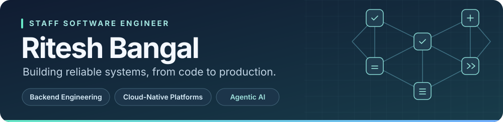

  

  <b>Java &amp; Distributed Systems</b> · <b>Cloud-Native Engineering &amp; DevSecOps</b> · <b>Applied Agentic AI</b>

  <a href="https://www.linkedin.com/in/riteshbangal/">LinkedIn</a> &nbsp;·&nbsp;
  <a href="https://dev.to/riteshbangal">Technical articles on DEV</a> &nbsp;·&nbsp;
  <a href="https://github.com/riteshbangal?tab=repositories">All repositories</a>

## About me

I'm a Staff Software Engineer based in the Netherlands, with 14+ years of experience across backend engineering, distributed systems and cloud-native platforms.

I enjoy designing secure, reliable systems and taking them from architecture to production. My recent focus is applying agentic AI to engineering automation, bringing together Python, RAG, MCP and developer tooling.

## Engineering toolkit

| Focus | Technologies |
| :--- | :--- |
| **Backend & distributed systems** | `Java` · `Spring Boot` · `Apache Kafka` · `REST APIs` · `Microservices` · `System Design` |
| **Cloud-native & DevSecOps** | `AWS` · `Kubernetes` · `Docker` · `Helm` · `Terraform` · `Istio` · `GitHub Actions` · `Jenkins` |
| **Agentic AI & automation** | `Python` · `FastAPI` · `LangChain` · `LangGraph` · `LangSmith` · `MCP` · `RAG` |
| **Data & observability** | `PostgreSQL` · `Redis` · `Prometheus` · `Grafana` · `Elasticsearch` |

## Featured repositories

Personal engineering labs, reference implementations and learning projects.

| Project | What you'll find |
| :--- | :--- |
| [**AWS CDK: The Path to Production**](https://github.com/riteshbangal/aws-cdk-path-to-production) | Java 21, AWS CDK, serverless infrastructure, versioned artifacts and GitHub Actions with OIDC; a gated Dev → QA → Prod release journey. |
| [**Kafka Deep Dive**](https://github.com/riteshbangal/kafka-deep-dive) | A growing Kafka reference workspace with Java and Python examples, local Docker environments and streaming concepts. |
| [**BuildMcpServer**](https://github.com/riteshbangal/BuildMcpServer) | A practical playground for building and debugging MCP servers using Python, FastMCP, uv and MCP Inspector. |
| [**gRPC Spring Boot Lab**](https://github.com/riteshbangal/grpc-spring-boot-lab) | A step-by-step Java learning lab for gRPC, Protocol Buffers, generated contracts, clients and servers. |
| [**LeetCode DSA Java Playbook**](https://github.com/riteshbangal/leetcode-dsa-java-playbook) | Pattern-first problem solving in Java, with invariants, reasoning, complexity analysis and revision notes. |
| [**Spring Boot Observability**](https://github.com/riteshbangal/springboot-prometheus-grafana) | A hands-on Spring Boot example with Actuator, Prometheus and Grafana. |

## Current exploration

I'm experimenting with AI-assisted developer workflows that discover suitable open-source contributions, assess issues, request human approval and help prepare changes and pull requests.

## Technical writing

**[Hello World, the Production Way: Java, AWS CDK and GitHub Actions](https://dev.to/riteshbangal/hello-world-the-production-way-java-aws-cdk-and-github-actions-2lgc)**

An end-to-end walkthrough of taking a simple application through a realistic, versioned and gated production delivery process.

---

  Open to conversations about Staff/Senior Backend, Platform and Agentic AI Engineering.
   
  <a href="https://www.linkedin.com/in/riteshbangal/"><b>Connect on LinkedIn</b></a>

